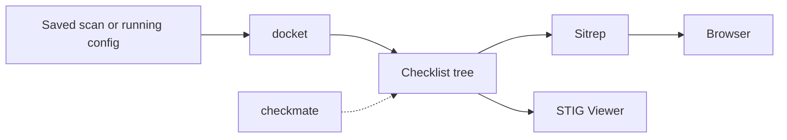

# Sitrep

Sitrep is the reader for a checklist tree. Ceasefire's `docket` writes the CKLB files. `checkmate` can edit a site fact the scan cannot see. Sitrep reads that tree and counts the statuses already stored in the files. It does not convert scans, write checklists, or import into STIG Viewer. Security still opens the same CKLB files in STIG Viewer.

The page is newest quarter first. List, Compare, and Attention are three views of the same rows. A bar under each host splits Open, Not reviewed, Not applicable, and Not a finding by count. Filter cards start collapsed. The benchmark filter shows the STIG version and release, such as V2R5. Appearance follows the browser until you choose Light or Dark.

The header shows the network Sitrep is running on, the date, and the user viewing the page.

## Dataflow



`docket` writes a `.cklb` and a `.cklb.provenance.json` sidecar into the tree. `checkmate` is optional and edits the CKLB in place. Sitrep and STIG Viewer both read that tree. Sitrep does not hand a file to STIG Viewer, and nothing writes back from the browser.

Mount any directory. Every `.cklb` under it is a row, at any depth. A directory named `2026-q4`, `Q4_2026`, or `2026Q4` becomes the quarter. Host, benchmark, and version come from the checklist. When two files describe the same host and benchmark in one quarter, Sitrep keeps the newer file.

An optional `expected.json` at the root of the tree lists hosts that should have a file. A name on that list with no `.cklb` is Missing. A file with no IP, an incomplete-snapshot note, or empty check text is Blocked. Anything else is Ready. Changed is the number of rule statuses that differ from the previous quarter for that same host and benchmark.

## Build

Sitrep is one static Linux binary. `scripts/build-sitrep.sh` compiles `dist/sitrep` and then builds a container image from `scratch` that contains only that binary. The image build does not pull a base image.

The build machine needs Go 1.22 or newer, with the standard library already installed. The script sets `CGO_ENABLED=0`, `GOOS=linux`, `GOPROXY=off`, and `GOTOOLCHAIN=local`. Podman is used when it is installed. Set `SITREP_RUNTIME` to `docker` or `podman` to choose the engine.

```sh
scripts/build-sitrep.sh
```

`SITREP_BUILD=0` skips the compile and the image build when the image is already present. `GOARCH` defaults to `amd64`. `GO_BIN` selects the `go` binary when it is not on `PATH`.

## Demo

`--demo` writes two quarters of sample checklists into `./data` and then builds the image. Compose mounts that directory at `/data`.

```sh
scripts/build-sitrep.sh --demo
docker compose up
```

`podman compose up` uses the same file. Open http://127.0.0.1:8787/

2026 Q4 in the demo shows a missing switch, a host with no IP, an incomplete Cisco snapshot, and rule statuses that moved since 2026 Q3.

`dist/sitrep demo-data --out DIR` writes that same tree without building the image.

## Run one container

`scripts/run-sitrep.sh` builds the scratch image when it is missing, then starts one container. It does not install a service. `CHECKLIST_DIR` is the checklist root on the host.

```sh
CHECKLIST_DIR=/private/checklists scripts/run-sitrep.sh podman
```

Pass `docker` instead of `podman` to use Docker. With no argument the script uses podman when it is installed. `HOST_PORT` changes the published port. The process inside the container listens on `8780`.

This command also mounts the system bus and `/run/systemd` when those paths exist, so the header can read the network name and the logged-in user. It mounts `/etc/localtime` on `/host/localtime` for the date.

## Install on a host

`scripts/install-sitrep.sh` builds the scratch image, then writes `/etc/systemd/system/sitrep.service`, enables it, and starts it. Run it as root. The argument is the checklist root.

```sh
sudo scripts/install-sitrep.sh /private/checklists
```

`--runtime docker` selects Docker. `--port` changes the published port. Podman is used when it is installed and `--runtime` is omitted.

```sh
systemctl status sitrep
systemctl restart sitrep
```

The unit mounts the checklist root at `/data` and `/etc/localtime` at `/host/localtime`. On the first install the script copies `config/console.env` to `/etc/sitrep/console.env` and leaves that file alone after that. Set `CHECKLIST_DOMAIN` there when the header should name the network. The unit does not mount the system bus, so the header uses `CHECKLIST_DOMAIN` or the host name.

On a host that already has the image loaded:

```sh
sudo SITREP_BUILD=0 scripts/install-sitrep.sh /private/checklists
```

## Disconnected host

Build where Go is already installed:

```sh
scripts/build-sitrep.sh
docker save -o sitrep.tar sitrep
```

`podman save` is the same step. On the disconnected host:

```sh
docker load -i sitrep.tar
sudo SITREP_BUILD=0 scripts/install-sitrep.sh /private/checklists
```

`podman load` is the same step. `SITREP_BUILD=0` uses the loaded image and does not compile again.

## Podman quadlet

`config/sitrep.container` is a user quadlet for a host that should start Sitrep at login. Build or load the image as `localhost/sitrep:latest`. Copy the unit to `~/.config/containers/systemd/`. Copy `config/console.env` to `~/sitrep/console.env`. Put the checklist tree at `~/sitrep/completed_ckl/`, or edit the `Volume` line to the real tree.

```sh
systemctl --user daemon-reload
systemctl --user enable --now sitrep
```

## Settings

| Name | Where | Meaning |
| --- | --- | --- |
| `CHECKLIST_ROOT` | inside the container | Tree the process reads. The image sets `/data`. |
| `CHECKLIST_DIR` | `run-sitrep.sh` | Host directory mounted on `/data`. |
| `CHECKLIST_DOMAIN` | `console.env` | Header name when the network has no DNS domain. |
| `CHECKLIST_USER` | environment | Header user when no seat user and no `Remote-User` header are present. |
| `PORT` | inside the container | Listen port. The image sets `8780`. |
| `HOST_PORT` | scripts | Port published on the host. Default `8787`. |
| `SITREP_IMAGE` | scripts | Image name. Default `sitrep`. |
| `SITREP_RUNTIME` | scripts | `podman` or `docker`. |
| `SITREP_BUILD` | scripts | `0` skips compile and image build when the image is already present. |
| `GO_BIN` | `build-sitrep.sh` | Path to the `go` binary. |
| `GOARCH` | `build-sitrep.sh` | Binary architecture. Default `amd64`. |
