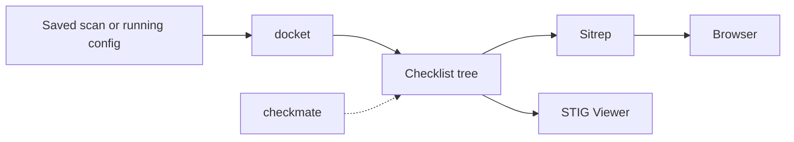

# Sitrep

Sitrep is the reader for a checklist tree. Ceasefire's `docket` writes the CKLB files. `checkmate` can edit a site fact the scan cannot see. Sitrep mounts the tree and counts what is already in the files. It does not convert scans, write checklists, or import into STIG Viewer. Security still opens the same CKLB files in STIG Viewer.

The page is newest quarter first. List, Compare, and Attention are three views of the same rows. A bar under each host splits Open, Not reviewed, Not applicable, and Not a finding by count. Filter cards start collapsed. The benchmark filter shows the STIG version and release, such as V2R5. Appearance follows the browser until you choose Light or Dark.

The header shows the network Sitrep is running on, the date, and the user viewing the page.

## Dataflow



`docket` writes a `.cklb` and a `.cklb.provenance.json` sidecar into the tree. `checkmate` is optional and edits the CKLB in place. Sitrep and STIG Viewer both read that tree. Sitrep does not hand a file to STIG Viewer, and nothing writes back from the browser.

Mount any directory. Every `.cklb` under it is a row, at any depth. A directory named `2026-q4`, `Q4_2026`, or `2026Q4` becomes the quarter. Host, benchmark, and version come from the checklist. When two files describe the same host and benchmark in one quarter, Sitrep keeps the newer file.

An optional `expected.json` at the root of the tree lists hosts that should have a file. A name on that list with no `.cklb` is Missing. A file with no IP, an incomplete-snapshot note, or empty check text is Blocked. Anything else is Ready. Changed is the number of rule statuses that differ from the previous quarter for that same host and benchmark.

## Install the demo

The demo image contains two quarters of test data.

```sh
docker compose up --build
```

`podman compose up --build` uses the same file. Open http://127.0.0.1:8787/

2026 Q4 in the demo shows a missing switch, a host with no IP, an incomplete Cisco snapshot, and rule statuses that moved since 2026 Q3.

## Install against a checklist tree

`CHECKLIST_DIR` is the tree on the host. The container reads it at `/data`.

```sh
CHECKLIST_DIR=/private/checklists scripts/run-sitrep.sh podman
```

`scripts/run-sitrep.sh docker` is the same command. With no argument the script uses podman when it is installed.

`config/console.env` sets `CHECKLIST_ROOT=/data`. Set `CHECKLIST_DOMAIN` in that file when the header should name the network.

## Disconnected host

Build where the base image is already present, then carry the tar:

```sh
docker build -t sitrep .
docker save -o sitrep.tar sitrep
```

Use `podman` the same way (`podman save` and `podman load`). On the disconnected host:

```sh
docker load -i sitrep.tar
CHECKLIST_DIR=/private/checklists scripts/run-sitrep.sh docker
```

Leave `SITREP_BUILD` unset after a load so the host does not try to pull a base image. Set `SITREP_BUILD=1` when you want the script to rebuild. `HOST_PORT` changes the published port. The process inside the container listens on `8780`.

## Podman at login

Copy `config/sitrep.container` to `~/.config/containers/systemd/`. Copy `config/console.env` to `~/sitrep/console.env`. Put the checklist tree at `~/sitrep/completed_ckl/`.

```sh
systemctl --user daemon-reload
systemctl --user enable --now sitrep
```

Build or load the image as `localhost/sitrep:latest` before enabling the unit.
